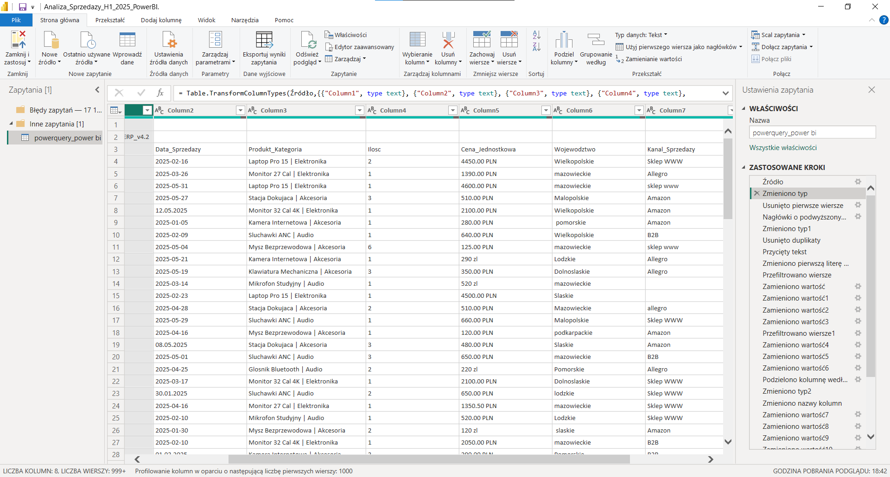
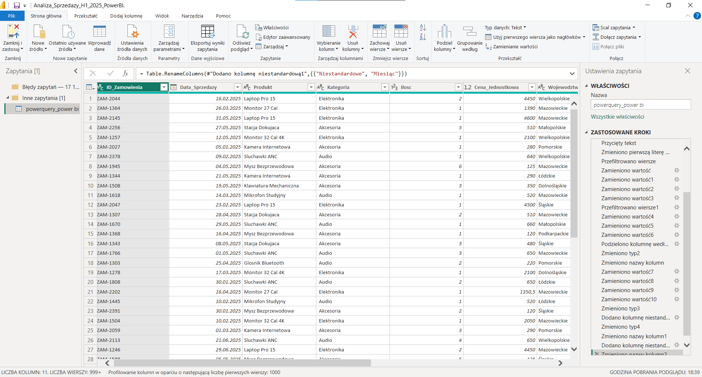
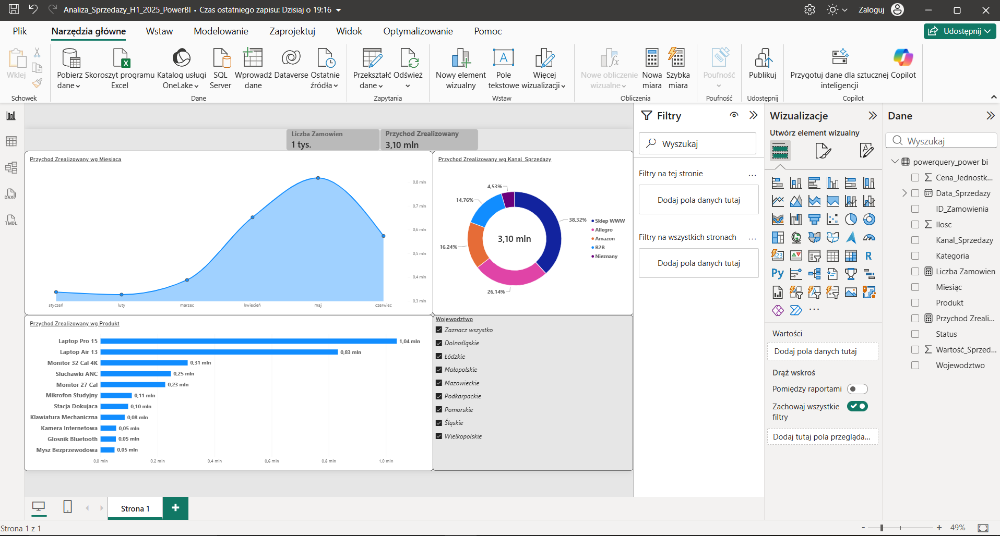

# E-commerce Sales Analysis (H1 2025) – ETL & Business Intelligence

## 1. Business Problem & Project Goal
The sales department had a raw ERP system export containing nearly 1,500 transactions from the first half of 2025. The dataset contained numerous system errors, duplicates, and inconsistent formatting, which prevented direct reporting in Excel and hindered data-driven decision-making.

**Key Project Objectives:**
- Build an automated data cleaning and transformation pipeline (ETL) in **Power Query**.
- Create a dynamic **DAX** measure model to monitor key performance indicators (KPIs).
- Design an interactive executive dashboard in **Power BI** answering business questions regarding sales seasonality, channel profitability, and top-performing products.

## 2. Data Cleaning & Transformation (ETL in Power Query)
The raw text file (`Analiza_Sprzedazy_H1_2025_PowerBI.txt`) required multi-step cleaning before loading into the data model. Completed steps included:
- **Metadata & Header Cleanup:** Filtered out the first two system metadata rows from the ERP report and promoted the proper header row.
- **Deduplication & Volume Validation:** Removed duplicate order IDs (`ID_Zamowienia`) and filtered out invalid records with negative quantities (`Ilosc < 0`) to prevent skewed metrics.
- **Date & Currency Standardization:** Unified mixed date formats (`YYYY-MM-DD` and `DD.MM.YYYY`) into a single `Date` data type. Cleaned currency suffixes (`PLN`, `zł`, `zl`) from the unit price column (`Cena_Jednostkowa`) and converted values using regional settings (*Using Locale*), eliminating 100% of parsing errors.
- **Text Dimensions & Missing Data Handling:** Removed extra whitespace (*Trim*), standardized letter casing across regions and sales channels (*Capitalize Each Word*), restored missing Polish diacritical marks in region names, and replaced null sales channel values with `"Nieznany"` (Unknown).
- **Feature Engineering:** Split the combined `Produkt_Kategoria` column into two separate analytical dimensions and created a calculated transaction value column.

### Power Query Transformation: Before & After
**Raw Data (At the Start):**


**Cleaned & Standardized Data (In the End):**


## 3. Data Modeling & DAX Measures
To ensure flexible slicing across regions, months, and sales channels, a set of dedicated DAX measures was built:

**Completed Revenue** *(core financial KPI filtering only paid and completed orders)*:
```dax
Przychód Zrealizowany = 
CALCULATE(
    SUM('powerquery_power bi'[Wartość_Sprzedazy]),
    'powerquery_power bi'[Status] = "Zrealizowane"
)
```

**Order Count** *(counting unique completed transactions)*:
```dax
Liczba Zamówień = 
CALCULATE(
    DISTINCTCOUNT('powerquery_power bi'[ID_Zamowienia]),
    'powerquery_power bi'[Status] = "Zrealizowane"
)
```

**Average Order Value (AOV)** *(supplementary KPI)*:
```dax
Średni Koszyk (AOV) = 
DIVIDE([Przychód Zrealizowany], [Liczba Zamówień], 0)
```

## 4. Key Business Insights
- **Overall Business Scale:** In H1 2025, the company generated **3.10M PLN** in revenue from completed orders across **over 1,000 unique transactions**.
- **Clear Seasonality (H1 2025 Trend):** Sales remained steady throughout Q1 (January–March), followed by dynamic growth in April and peaking in May, with a slight correction in June.
- **Computer Category Dominance (Pareto Principle):** Two flagship products — *Laptop Pro 15* (1.04M PLN) and *Laptop Air 13* (0.83M PLN) — account for **over 60% of total company revenue**. Peripherals (mice, speakers, webcams) serve as complementary add-ons.
- **Sales Channel Diversification:** The largest revenue shares come from the proprietary **Online Store (~28.3%)** and **Allegro (~26.1%)**, strongly supported by **B2B (~16.3%)** and **Amazon (~14.7%)**. A small fraction (~4.5%) represents orders with an unassigned channel (*Unknown*), highlighting a need to improve form validation in the ERP system.

## 5. Interactive Power BI Dashboard

